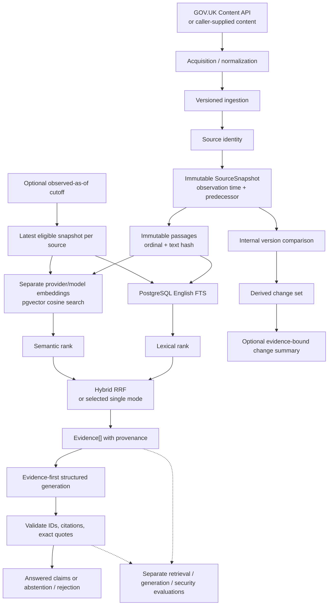

# Architecture

The public query path reads immutable, locally observed source versions and returns either validated evidence-bound claims or an abstention. Version comparison and its optional generated summary are internal services; there is no version-comparison HTTP endpoint.

## Data and service boundaries

- **Acquisition → persistence:** `api.govuk_acquisition` fetches and normalizes configured GOV.UK Content API responses. `VersionedIngestionService` accepts an `ObservedSourceVersion` containing source identity, bytes, retrieval URL, and timezone-aware observation time; callers can supply content without live acquisition. The service hashes the content, creates immutable snapshots/passages in one transaction for a new observation, and links a new snapshot to its predecessor. An identical source/content hash reuses the existing snapshot. Source publication/update time is provenance; local `observed_at` drives temporal eligibility.
- **Corpus → embeddings:** `sources`, `source_snapshots`, and `passages` hold observed content and provenance. `passage_embeddings` holds derived `vector(1536)` records keyed by passage and provider/model. A passage can therefore have multiple embedding versions without changing its original text or hash. Indexing missing embeddings is an explicit operation.
- **Retrieval → generation:** `VersionedRetriever` selects the latest eligible snapshot for each source. Lexical mode ranks with PostgreSQL English full-text search; Semantic mode filters embeddings by provider/model and ranks with pgvector cosine distance; Hybrid mode fuses their ranks using RRF with constant 60 and bounded candidates. Hybrid reads both rankings in a consistent database snapshot. All three return immutable `Evidence` values with source, snapshot, passage, observation, and ranking provenance. No ORM object crosses this boundary.
- **Evidence → answer:** `EvidenceFirstAnswerService` assigns IDs such as `E1` to the selected evidence, serializes source fields and passage text as JSON data, and sends fixed application instructions to an `AnswerGenerationProvider`. The OpenAI adapter is opt-in; tests inject fake providers. The answer service checks every returned claim's citation ID and exact supporting quote, rejects malformed output, and assembles human-readable answer text only from accepted claims. No evidence short-circuits to abstention without calling the provider.
- **Trusted → untrusted content:** source titles, URLs, passage text, and the question are untrusted. They cannot create or redefine application-side evidence IDs or schema rules. Role-like strings remain passage data. This is a structural boundary plus output validation; it does not establish that a model will always ignore adversarial prose or that an exact quote entails its claim.
- **Domain → HTTP:** `api.main` constructs database, embedding, retrieval, and answer dependencies for `/api/query`; FastAPI tests replace them with fakes. `api.query_service` composes retrieval and generation and serializes the public response. Chunks mode stops after retrieval. Validated claim citations are the source links for an answered result; retrieved chunks are separate inspection data. `/api/status` reports versioned-corpus readiness.
- **Bootstrap → schema:** `initdb/000-init.sql` creates the application role and pgvector extension. Alembic owns application tables, constraints, and indexes, including the migration that removes old tables. The disposable integration database checks the upgrade/downgrade chain against real PostgreSQL/pgvector.

## Observed-as-of semantics

For each source, retrieval chooses its latest snapshot with `observed_at <= as_of`, or its latest observation when no cutoff is provided. A source first observed after the cutoff contributes nothing. This describes what **this corpus had observed by that time**; it does not reconstruct an authoritative historical GOV.UK publication state. A timezone-aware `as_of` is required. The Content API publication/update timestamps are shown as provenance and do not replace local observation time.

## Version comparison

`VersionComparisonService` accepts two explicit snapshot IDs, a snapshot plus its recorded predecessor, or two observed-as-of cutoffs for one source. Different sources, self-comparisons, missing snapshots, and reversed/equal observation order are rejected. `VersionChangeSet` is computed from immutable snapshots and is not persisted. At each passage ordinal, matching hashes are `unchanged`, differing hashes are `modified`, and an ordinal present on only one side is `added` or `removed`. The record retains exact old/new text and provenance.

`VersionChangeSummaryService` can turn material changes into separately labeled older/newer evidence and reuse the same structured answer/citation validator. A claim citing one side of a modified passage must cite the other. No material changes yield a deterministic no-change result without a provider call. Ordinal matching is a textual baseline: an insertion or changed chunk boundary can make several passages appear modified even when the conceptual edit is smaller. Different hashes do not prove a semantic contradiction.
